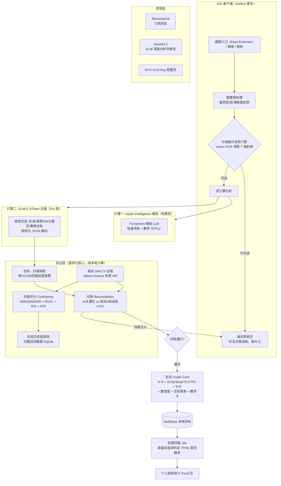
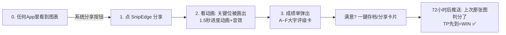

# TR-20260930-图表评级AI（SnipEdge）-操作指南

> **本文档目标**：任何 LLM / 开发者拿到本文档后，可以从零复刻出一款在功能、UI、信任度、价格策略上**全面碾压** Chart Detector AI / GraphIQ / Chartify / Chartmaxx / Chartby 等同类竞品的 iOS 原生 App。
> **竞品来源**：TR-20260917-1318-全球商机调查报告.md 之 #3 Chart Detector AI（$56,000/月，TikTok 投放驱动）
> **调研方法**：pain-point-hunter SKILL（Reddit / App Store 差评采集）+ GitHub 开源项目调研（YOLOv8 图表形态识别 / yfinance-ta-patterns 共振评分引擎 / vectorbt 回测）
> **报告日期**：2026-09-30

---

# 0. APP 命名与副标题（写在最上面，最重要）

## 0.1 最终命名

| 项目 | 内容 |
|------|------|
| **App 名称（Name, 30字符内）** | **SnipEdge: AI Chart Grades** |
| **副标题（Subtitle, 30字符内）** | **Snap a chart. Get the grade.** |
| **中文项目代号** | 图表评级AI |
| **包名/Bundle** | com.yourcompany.snipedge |

> ⚠️ 命名已规避：Chart AI / Chartify / Chartmaxx / Chartby / GraphIQ / ChartSnipe / SnapPChart / ChartingLens / ChartCheck / ChartAnalyst / ChartChatAI / TradeGPT / TradingWizard / Trader AI / Trade AI / iTrade AI / TodayChart / ShotCaller / ChartScanAI 等所有 App Store 已存在名称。**上架前最后一步：在 App Store Connect「新建 App」输入名称时，若提示名称被占用，依次启用 0.4 备选名单。**

## 0.2 命名为什么是 SnipEdge（五维度分析）

1. **品牌记忆度（最关键）⭐⭐⭐⭐⭐**
   - `Snip`（截图/剪裁）+ `Edge`（交易优势 "trading edge"，交易圈最热的行话）。
   - 两个单音节词，2 秒念完，交易者听到立刻懂："Snip（截个图）→ Edge（拿到优势）"。
   - "Edge" 在美国交易社区（r/Daytrading、X/Twitter fintwit）是高频信仰词，自带传播基因：*"Where do you get your edge?"* → *"SnipEdge."*
2. **病毒传播性 ⭐⭐⭐⭐⭐**
   - 可造动词句："Did you SnipEdge it yet?" / "Snip it, grade it, trade it."（TikTok 口号）
   - 用户晒"成绩单"（A-F 评级卡）时，卡片右下角印 "Graded by SnipEdge"——每个分享卡都是免费广告位（复刻 Symmetry 的 UGC 分成逻辑但零成本）。
3. **功能描述性 ⭐⭐⭐⭐⭐**
   - 名字直接描述核心动作：截图（Snip）→ 输出优势（Edge）。新手第一次看名字就明白 App 干什么。
4. **ASO 搜索优化 ⭐⭐⭐⭐**
   - 名称后缀 "AI Chart Grades" 精准命中类目高频搜索词：`chart analysis` / `chart AI` / `trade grade` / `chart pattern`。
   - 副标题 "Snap a chart. Get the grade." 重复动作+结果，强化"截图→评级"心智，同时覆盖 `snap` / `chart` / `grade` 三个搜索词根。
5. **国际化适配 ⭐⭐⭐⭐⭐**
   - 纯英文、无生僻拼写、无文化歧义；全球英语市场（美国/英国/澳洲/加拿大/新加坡）均可直接理解；发音无需教学。

## 0.3 副标题与关键词备选

| 方案 | 副标题（30字符内） | 侧重 |
|------|------|------|
| A（默认） | Snap a chart. Get the grade. | 动作+结果，最顺口 |
| B | AI chart grades & win rates | 强调差异化：胜率 |
| C | Your chart. Graded in 10s. | 强调速度 |

## 0.4 备选名称（名称被占用时依序启用）

1. **SnapGrade: AI Chart Analysis**
2. **TradeGrader: Chart AI**（若占用则 TradeGrader AI）
3. **LevelSnap: AI Chart Levels**
4. **ChartPunch: AI Trade Grades**

---

# 1. 竞品与痛点研究结论（痛点即需求，需求即功能）

## 1.1 类目现状

- Chart Detector AI 类产品（GraphIQ / Chartify / Chartmaxx / Chartby / Chart AI / Trader AI / Trade AI 等数十款）模式高度一致：**截图→多模态 LLM 读图→给结论**，硬付费墙 + 周订阅 $7.99 / 年 $79.99，靠 TikTok 付费投放获客，头部 $56K/月。
- 横向对手还包括网页型工具：ChartSnipe（$24/月）、SnapPChart、ChartingLens（$14.99/月）、TradingWizard AI 等。
- **市场顺风**：美国 PDT 规则（日内交易最少 $25,000 账户限制）已于 2026 年 4 月废除，小账户日内交易者激增——散户图表工具需求正在加速放大。

## 1.2 用户原话级痛点（pain-point-hunter 采集，2026-06~09）

| # | 用户原话/证据 | 翻译 | 竞品为何解决不了 |
|---|---|---|---|
| P1 | *"If I upload the same screenshot twice and get two different support levels, that's done."*（r/SideProject 高赞） | 同一张图上传两次，给出两个不同的支撑位，直接弃用 | LLM 视觉输出天然非确定性，无一致性校验层 |
| P2 | *"You get clean looking support at a price it made up."*（AI 读图开发者复盘） | Y 轴被裁掉时，AI 照样画出"漂亮"的支撑位——价格是它编的 | 竞品无"价格轴可读性检测"，编造数字还装自信 |
| P3 | *"A wrong read is now wrong the same way every time… determinism is not accuracy."* | temperature=0 只是让错误可复现，不是让结果正确 | 竞品把"可复现"当"准确"卖 |
| P4 | 类目评论综合：*"分析结果泛泛、每次说法不一样、不敢真按它操作"* | 结论无法验证、不敢执行 | 无历史胜率、无 OHLCV 对账、无结果回看 |
| P5 | 硬付费墙：先扣 $7.99 周费才能用第一次 | 用户没体验就扣钱，差评重灾区 | 竞品 CFO 逻辑：投流贵必须硬墙收割 |
| P6 | 新手看不懂"头肩顶颈线""RSI 背离" | 只给结论不给教学，新手流失 | 竞品把教学当成本而非留存钩子 |
| P7 | 分析完没有下文：不知道上次的分析对了没有 | 无复盘闭环 → 无法建立信任 → 弃用 | 竞品无结果追踪（Outcome Tracking） |

**痛点评分：💎 钻石级 88/100**（付费意愿 20/20 + 市场规模 12/15 + 可实现性 18/20 + 具体性 22/25 + 独特性 16/20）

## 1.3 碾压策略一句话

> **竞品卖的是"AI 的说法"，SnipEdge 卖的是"可验证的证据"。**
> 每一次分析都附带：① 价格轴可读性门禁（读不了就诚实拒绝）② 真实 OHLCV 对账 ③ 该形态的历史胜率 ④ 结果自动回看（对/错追踪）。把类目全部差评（P1~P7）逐一做成功能。

---

# 2. 产品定义

## 2.1 一句话定位

**"Snap any trading chart screenshot → get an A–F grade with verified levels, historical win rate, and a trade plan — in 10 seconds."**

（截任意交易图表 → 10 秒拿到 A–F 评级 + 经过真实行情验证的关键位 + 历史胜率 + 完整交易计划）

## 2.2 功能矩阵（vs 竞品）

| 功能 | 竞品（Chart AI 类） | SnipEdge |
|---|---|---|
| 截图→AI 分析 | ✅ | ✅ |
| A–F 交易评级卡（Entry/Stop/TP1/TP2/R:R） | ❌（只有文字结论） | ✅ |
| **价格轴可读性门禁**（读不出刻度→诚实拒绝） | ❌ | ✅ 核心信任卖点 |
| **真实 OHLCV 对账**（AI 读的位 vs 真实行情） | ❌ | ✅ |
| **形态历史胜率**（内置回测数据库） | ❌ | ✅ |
| **结果自动回看**（TP/SL 是否打到，自动判定对错） | ❌ | ✅ 留存核心 |
| 同图结论一致性（存档对比） | ❌ | ✅ |
| 教学模式（每个结论可展开"为什么"） | ❌ | ✅ |
| 免费体验后再付费 | ❌ 硬付费墙 | ✅ 免费 3 次/天 |
| BYO API 模式（高级用户自带 Key 无限用） | ❌ | ✅ |
| 深色专业交易审美 UI | 一般 | ✅ |

## 2.3 合规定位（App Store 审核红线）

- 全程定位 **"Education & Analysis"（教育/分析工具）**，绝不出现 "buy/sell signal guaranteed"、"profit" 等承诺性文案。
- 首屏+分析页固定免责声明："Educational analysis only. Not financial advice."
- 分类建议：**Finance**（若 Finance 审核趋严则备选 Education）。
- AI 结果页强制显示评级 ≠ 建议，且 Stop Loss 与 R:R 必须同时展示（展示风险管理=过审友好+专业信任）。

---

# 3. 实现流程图（系统架构）



**架构三原则：**
1. **AI 负责读图，数学负责下结论**——LLM 只输出"看到了什么"（结构化 JSON），评级/止盈止损/胜率全部由确定性本地引擎计算。这直接消灭 P1/P3（两次结果不同、错误但自信）。
2. **门禁先行**——价格轴读不出来就拒绝分析，宁可少一单也不编造（消灭 P2，并把"诚实"变成信任卖点，SnapPChart 已验证"诚实路径"能引发社区自来水传播）。
3. **一切可回看**——每条分析 72 小时后自动判分，个人胜率页让用户"看见自己变强"（消灭 P7，留存飞轮）。

---

# 4. 用户使用流程图（极简，零学习成本）

## 4.1 主流程（3 步搞定，爽感设计）



**爽感设计细节（"看爽文小说"式体验）：**

| 用户动作 | 界面反馈 | 爽点 |
|---|---|---|
| 分享一张截图到 SnipEdge | 无需打开 App、无需注册、无需选参数 | **零输入**——市面唯一"完全零输入"的图表工具 |
| 分析进行中 | K 线上动态描画支撑/阻力线的动画（像老师在你图上画线）+ 0.8s 节拍音效 | 仪式感/掌控感 |
| 结果弹出 | 大字 A–F 评级 + 三色风险区 + "R:R 1:2.8" 高亮 | 一眼读懂，多巴胺峰值 |
| 点任何结论 | 展开"为什么"（人话教学，20字以内） | 每次用都在变强（学习成就感） |
| 收到判分推送 | "Monday 的 NVDA 分析：WIN ✅ +2.1R" | 赌局开牌的快感 + 信任累积 |
| 连续 5 次 WIN | 解锁 "Hot Streak 🔥" 徽章 + 生成分享卡 | 社交货币（TikTok 传播素材） |

## 4.2 首次启动（3 屏结束，绝不做 onboarding 问卷）

```
屏1: 一张演示图自动分析动画 → "This is what you'll get." 
屏2: 通知权限（文案: "We'll grade your past picks in 72h" —— 用利益换权限）
屏3: 直接进主界面，剩余免费次数 3/3 大字显示 → 立即引导: "分享任意图表试试"
```

> 竞品在 onboarding 塞 6-8 屏订阅墙（转化套路），SnipEdge 用"3 次免费先爽到"代替——把 P5（硬付费墙差评）反转成获客文案："Try before you pay. 3 free grades every day."

---

# 5. 软件数据流图（防错设计重点）

```mermaid
flowchart TD
    subgraph IN["输入层"]
        IMG[UIImage 截图] --> Q{质量门禁 QualityGate}
        Q -- 模糊/过小/纯文字 --> R1[拒绝: 具体原因+如何截图教程]
        Q -- 通过 --> AXIS[Vision OCR: 读取Y轴价格刻度+X轴时间]
        AXIS -- 刻度<2个 --> R2[拒绝: “价格轴被裁掉，无法给出真实价位”]
        AXIS -- OK --> COORD[轴标定: 像素↔价格 线性映射系数]
    end

    subgraph AI["AI 读取层"]
        PROMPT[严格结构化Prompt<br/>输出JSON Schema] --> GLM[GLM-5.3-Flash Vision<br/>temperature=0, seed固定]
        GLM --> J1[JSON: 形态/趋势/关键位像素坐标/多周期观察]
        J1 --> VAL[Schema校验失败→自动重试1次<br/>仍失败→降级Apple端侧]
        VAL --> MAP[像素坐标→价格换算<br/>使用COORD系数]
    end

    subgraph FACT["事实校验层（防幻觉核心）"]
        FETCH[拉取真实OHLCV<br/>Yahoo Finance chart API 免费无Key<br/>按图内周期+最近300根]
        FETCH --> REC{对账: 每个AI关键位<br/>±1.5%内存在真实K线高低点?}
        REC -- 不通过 --> FLAG[标记 UNVERIFIED<br/>卡片黄色警示“AI识别位未经行情验证”]
        REC -- 通过 --> GREEN[标记 VERIFIED ✅]
    end

    subgraph QUANT["量化评分层（确定性，无AI参与）"]
        IND[计算真实指标: EMA20/50/200, RSI14, ATR14, RVOL]
        CONF[共振分 0~1: 趋势对齐+量能+RSI位置+ATR状态]
        WIN[胜率查询: 形态×市场×周期 → 内置回测库]
        PLAN[交易计划: Entry=关键位, Stop=1.5×ATR, TP1=1.5R, TP2=3R]
        GRADE[A~F评级 = f(共振分, 胜率, R:R, 对账结果)]
    end

    MAP --> REC
    IND --> CONF
    FETCH --> IND
    CONF --> GRADE
    WIN --> GRADE
    PLAN --> GRADE
    GREEN/FLAG --> GRADE

    subgraph OUT["输出与沉淀层"]
        CARD[Grade Card 渲染]
        DB[(SwiftData: 图像指纹hash/JSON/判定任务)]
        DB --> JOB[收盘后Job: 用真实OHLCV判定 WIN/LOSS/OPEN]
        JOB --> PROOF[个人胜率页: 总胜率/平均R/连续胜场]
    end

    CARD --> DB
```

**防错设计清单（逐条对应痛点）：**

| 防错机制 | 防什么 | 实现 |
|---|---|---|
| 质量门禁 | 模糊图/非K线图瞎分析 | Vision 检测清晰度 + 烛台检测（连续≥15根红绿柱才算图表） |
| 轴标定门禁 | AI 编造价格（P2，最危险） | OCR 读出 ≥2 个 Y 轴刻度才允许给出绝对价位 |
| Schema 校验+重试 | LLM 输出不合法 JSON | JSON Schema 校验，失败重试，二失败降级端侧模型 |
| OHLCV 对账 | 幻觉支撑阻力位（P1/P3） | AI 位 vs 真实 K 线 ±1.5% 容差对账，未过=黄牌标注 |
| 固定 seed+温度0 | 同图两次结果不同（P1） | 云端参数锁定；且结果存档，同 hash 图直接显示"上次结论对比" |
| 确定性计算层 | "AI 说法不一致" | 评级/止损/目标全部本地公式计算，AI 不参与决策 |
| 结果判分 | 分析完没下文（P7） | 每条存档 72h 后自动判 WIN/LOSS（先触 TP=WIN，先触 SL=LOSS） |

---

# 6. 核心技术实现与代码示例

## 6.1 GitHub 可二次开发参考项目（已调研）

| 项目 | Stars | 作用 | 二开方式 |
|---|---|---|---|
| [Omar-Karimov/ChartScanAI](https://github.com/Omar-Karimov/ChartScanAI) | 157+ | YOLOv8 K线形态检测（基于 IEEE 论文 "YOLO Object Recognition & Buy-Sell Decision over 2D Candlestick Charts"），Streamlit 演示 | 参考其标注/训练管线思路；移动端改用 GLM-5.3-Flash 视觉替代本地 YOLO（省模型体积），保留其 prompt/标注方法论 |
| [eminsk/yfinance-ta-patterns](https://github.com/eminsk/yfinance-ta-patterns) | 新项目 | **共振评分引擎（最有价值）**：EMA20/50/200 对齐 + 零前视 RVOL + Wilder RSI + ATR → 0~1 共振分；ATR 止损 + 1.5R/3R 分级止盈；LLM-ready JSON | **核心算法直接移植为 Swift**（公式清晰、纯 NumPy 向量化逻辑，翻译成本低），见 6.4 |
| [polakowo/vectorbt](https://github.com/polakowo/vectorbt) | 9.1k | 工业级向量化回测 | 用 Python 脚本**离线批量跑**形态历史胜率，产出 SQLite 随包内置（App 内不跑回测，保证秒级响应） |
| [backtesting.py](https://github.com/kernc/backtesting.py) | 13k+ | 轻量回测 | 备选回测器 |
| [cm45t3r/candlestick](https://github.com/cm45t3r/candlestick) | 322 | JS 烛台形态布尔检测 | 移植其形态判定阈值（Hammer/Engulfing 等参数）到 Swift |

## 6.2 Apple Intelligence（端侧免费引擎）——Foundation Models 框架

```swift
// SnipEdgeAI.swift —— iOS 26 Foundation Models（用户 small account 已可免费调用）
import FoundationModels

enum SnipEdgeOnDevice {
    /// 端侧：教学解释 + 快速点评（免费层可用，零成本）
    static func explain(grade: GradeCard) async throws -> String {
        let session = LanguageModelSession(instructions: """
        You are a patient trading tutor. Explain in ≤2 short sentences, plain English, \
        why this setup got this grade. Never give financial advice.
        """)
        let response = try await session.respond(to: """
        Pattern: \(grade.patternName); Grade: \(grade.letter); Confluence: \(grade.confluenceScore); \
        R:R: \(grade.riskReward); Market: \(grade.symbol) \(grade.timeframe)
        """)
        return response.content
    }
}
```

## 6.3 GLM-5.3-Flash（云端视觉引擎，面向美国用 Z.ai 端点）

> 📌 **GLM 配置文档与配置标准（唯一权威来源）**：`https://github.com/asunnyboy861/GLM-Cloudflare`
> - 该仓库包含 GLM-5.3-Flash API 的配置文档、端点/鉴权/配额约定与部署标准（Cloudflare 代理层）。
> - **iOS 前端不需要自己发明配置方式**：已有与该配置标准匹配的 **GLM API Skill** 负责在项目中添加/配置 GLM API（生成时按该 skill 的标准配置即可，端点、Key 注入、超时与重试均遵循其约定）。
> - 生产部署走该仓库定义的 Cloudflare 代理层：客户端只请求代理端点，真实 GLM Key 只存在于代理环境变量中（对应第 11 节"Key 泄露"风险对策）。
> - 原始协议参考：`https://docs.bigmodel.cn`；美国用户走 `https://api.z.ai`（智谱统一 Key 体系，BigModel Key 直接可用）。
> - ⚠️ **访问备注（2026-09-30 核实）**：该仓库当前返回 404（私有或未公开）。实施第一步：由仓库所有者将其设为 Public（或授予协作者权限）后，读取 README 作为配置基线；在此之前，按本节代码示例 + docs.bigmodel.cn 协议先行开发，代理层上线后仅替换 `baseURL`。

> 文档：`https://docs.bigmodel.cn`；美国用户统一走 `https://api.z.ai/api/paas/v4/chat/completions`（智谱统一 Key 体系，BigModel Key 直接可用）。**Key 为消耗品，只在服务端/付费路径调用，禁止买断送无限调用。**
>
> ⚠️ **GLM 只是"官方默认引擎"，严禁写死为唯一模型**：BYO 模式必须支持多服务商任选——**GLM / OpenAI / Claude / Gemini / DeepSeek / 自定义模型**，配置标准见 6.3.1（按 iOS 生成 Skill 的 BYO API 标准模板实现）。

```swift
// GLMClient.swift —— 生产环境务必经自建轻量代理（隐藏Key + 配额控制），此处展示直连协议
struct GLMVisionRequest: Encodable {
    struct Message: Encodable { let role: String; let content: [Content] }
    struct Content: Encodable { let type: String; var text: String?; var image_url: ImageURL? }
    struct ImageURL: Encodable { let url: String }   // data:image/jpeg;base64,...
    let model = "glm-4.6v"            // 按当前可用视觉型号填写（docs.bigmodel.cn 查最新）
    let messages: [Message]
    let temperature = 0.0             // 确定性（但见 6.4：确定性≠正确，必须配对账层）
    var seed = 42
}

func analyzeWithGLM(imageJPEG: Data, prompt: String, apiKey: String) async throws -> ChartReading {
    var req = URLRequest(url: URL(string: "https://api.z.ai/api/paas/v4/chat/completions")!)
    req.httpMethod = "POST"
    req.setValue("application/json", forHTTPHeaderField: "Content-Type")
    req.setValue("Bearer \(apiKey)", forHTTPHeaderField: "Authorization")

    let b64 = imageJPEG.base64EncodedString()
    let body = GLMVisionRequest(messages: [
        .init(role: "system", content: [.init(type: "text", text: Self.systemPrompt)]),
        .init(role: "user", content: [
            .init(type: "image_url", image_url: .init(url: "data:image/jpeg;base64,\(b64)")),
            .init(type: "text", text: prompt)
        ])
    ])
    req.httpBody = try JSONEncoder().encode(body)
    let (data, _) = try await URLSession.shared.data(for: req)
    // 解析 choices[0].message.content → 按 JSON Schema 解码为 ChartReading
    return try Self.decodeReading(from: data)
}

/// 严格结构化 Prompt（核心资产——LLM只描述"看到什么"，绝不给价位结论）
static let systemPrompt = """
You are a chart-reading instrument, NOT an advisor. Output ONLY JSON matching:
{"chart_type":"candles|line","instrument_guess":"string|null","timeframe_guess":"string|null",
 "pattern":{"name":"string|null","confidence":0-1},
 "trend":"up|down|range",
 "levels":[{"kind":"support|resistance","y_pixel":int,"confidence":0-1}],
 "notes":"string"}
Rules: y_pixel = pixel row in the image. If you cannot see the price axis, still report
y_pixel values and set notes="AXIS_MISSING". Never invent absolute prices.
"""
```

## 6.3.1 BYO API 多模型配置标准（严禁写死单一模型，按 iOS 生成 Skill 的 BYO 模板实现）

**原则**：BYO（Bring Your Own Key）模式让用户使用**自己的任意服务商 Key** 解锁无限深度分析。实现时禁止硬编码只有一个 GLM——必须支持 **GLM / OpenAI / Claude / Gemini / DeepSeek / 自定义模型** 六类，UI 与数据结构按 iOS 生成 Skill 的 BYO API 标准模板生成（字段、Keychain 存储、连通性测试均遵循该模板，不额外发明样式）。

**协议适配策略**（一个客户端吃下所有服务商）：

| 服务商 | 协议 | 默认 Base URL | 预置视觉模型示例 |
|---|---|---|---|
| GLM（智谱） | OpenAI 兼容 | `https://api.z.ai/api/paas/v4`（或 GLM-Cloudflare 代理） | glm-4.6v / glm-5.3-flash（以官方文档为准） |
| OpenAI | OpenAI 原生 | `https://api.openai.com/v1` | gpt-4o / gpt-4o-mini |
| Claude（Anthropic） | Anthropic 原生（`/v1/messages` + `x-api-key`） | `https://api.anthropic.com` | claude-sonnet-4-5 等 |
| Gemini | OpenAI 兼容端点 | `https://generativelanguage.googleapis.com/v1beta/openai` | gemini-2.0-flash |
| DeepSeek | OpenAI 兼容 | `https://api.deepseek.com/v1` | deepseek-chat（纯文本，见能力门禁） |
| 自定义 | OpenAI 兼容（可改 Base URL） | 用户自填 | 用户自填 model 名 |

```swift
// BYOConfig.swift —— 多服务商配置（按 iOS 生成 Skill 的 BYO 标准模板字段命名）
enum AIProvider: String, CaseIterable, Codable {
    case glm, openai, claude, gemini, deepseek, custom

    var defaultBaseURL: String {
        switch self {
        case .glm:      return "https://api.z.ai/api/paas/v4"
        case .openai:   return "https://api.openai.com/v1"
        case .claude:   return "https://api.anthropic.com"
        case .gemini:   return "https://generativelanguage.googleapis.com/v1beta/openai"
        case .deepseek: return "https://api.deepseek.com/v1"
        case .custom:   return ""            // 用户自填
        }
    }
    var supportsVisionByDefault: Bool { self != .deepseek }   // 预置判断，用户可覆写
}

struct ProviderProfile: Codable, Identifiable {
    var id: UUID = UUID()
    var provider: AIProvider
    var baseURL: String          // 预填 defaultBaseURL，可编辑（custom 必填）
    var apiKeyRef: String        // Keychain 键名——Key 永不进 SwiftData/UserDefaults
    var model: String            // 用户自选或手填模型名
    var supportsVision: Bool     // 深度分析需要视觉能力；纯文本模型自动降级为仅文本任务
    var isActive: Bool           // 当前生效的 Profile
}

// 请求分发：OpenAI 兼容系共用一个 client；Claude 单独适配（/v1/messages + vision block 格式）
protocol VisionClient { func analyze(imageJPEG: Data, prompt: String) async throws -> ChartReading }
// OpenAICompatibleClient(baseURL:model:apiKey:)  → 覆盖 GLM/OpenAI/Gemini/DeepSeek/自定义
// AnthropicClient(baseURL:model:apiKey:)        → 覆盖 Claude
```

**UI 模板（按 iOS 生成 Skill 的 BYO 标准组件）**：

```
设置 → AI 引擎（BYO）
├─ 服务商选择器: [GLM] [OpenAI] [Claude] [Gemini] [DeepSeek] [Custom]   ← 分段控件，选中即预填 baseURL
├─ Base URL 文本框（预填默认值，custom 强制必填 + URL 格式校验）
├─ API Key 安全输入框（粘贴 → 存 Keychain，显示 •••• 尾4位）
├─ 模型名输入框 + 常用模型快捷芯片（如 GLM: glm-4.6v / OpenAI: gpt-4o）
├─ 视觉能力开关（默认按服务商预置；DeepSeek/纯文本模型开启时提示"将只用于文本任务"）
├─ [测试连接] 按钮 → 发 1 次最小请求 → 成功绿勾/失败红叉+错误码
└─ 已保存 Profile 列表（多 Profile 并存，单选激活；删除有确认）
```

**规则**：
1. BYO 激活后深度分析直接走用户 Key/端点（不消耗官方 GLM 配额、不经过官方代理——除非该服务商选择 GLM 且填了 GLM-Cloudflare 代理地址）。
2. 官方默认引擎（GLM-Cloudflare 代理）与 BYO Profile 并存：未配置 BYO 时用官方引擎（受订阅配额限制）；配置并激活 BYO 后 BYO 优先且不限次。
3. Key 只进 Keychain；日志/崩溃上报全链路脱敏；测试连接请求不携带用户截图。
4. 视觉能力门禁：`supportsVision == false` 的 Profile 不允许作为深度分析引擎（灰置入口 + 解释文案），防止纯文本模型瞎答读图任务——这是 5.5 防错设计在 BYO 侧的延伸。

## 6.4 确定性评分引擎（从 yfinance-ta-patterns 移植为 Swift）

```swift
// ConfluenceEngine.swift —— 确定性层：无 AI 参与，同样的输入永远同样的输出
struct ConfluenceEngine {
    /// 输入: 真实 OHLCV（Yahoo Finance 拉取）; 输出: 共振分 + A~F 评级 + 交易计划
    static func grade(ohlcv: [Bar], reading: ChartReading, levels: [VerifiedLevel]) -> GradeCard {
        let ema20  = ohlcv.ema(20), ema50 = ohlcv.ema(50), ema200 = ohlcv.ema(200)
        let rsi    = ohlcv.rsi(14)          // Wilder 平滑
        let atr    = ohlcv.atr(14).last!
        let rvol   = ohlcv.relativeVolume(lag: 20)   // 零前视: 只用已完成K线

        var score = 0.0
        let last = ohlcv.last!.close
        score += trendAlignment(last, ema20, ema50, ema200, bias: reading.trend) // 0.4
        score += min(rvol / 2.5, 1.0) * 0.2                                      // 量能 0.2
        score += rsiPosition(rsi, bias: reading.trend) * 0.2                     // 0.2
        score += atrExpansion(ohlcv) * 0.2                                       // 0.2

        let winRate = PatternStats.shared.winRate(pattern: reading.pattern.name,
                                                  timeframe: reading.timeframeGuess)
        let entry  = levels.first(where: { $0.kind == .support })?.price ?? last
        let stop   = entry - 1.5 * atr
        let tp1    = entry + 1.5 * (entry - stop)      // 1.5R
        let tp2    = entry + 3.0 * (entry - stop)      // 3.0R
        let rr     = (tp1 - entry) / (entry - stop)
        let letter = letter(for: score, winRate: winRate, rr: rr, verified: levels.allSatisfy(\.verified))
        return GradeCard(letter: letter, confluenceScore: score, winRate: winRate,
                         entry: entry, stop: stop, tp1: tp1, tp2: tp2, riskReward: rr)
    }
}
```

## 6.5 结果判分（Outcome Tracker，留存飞轮）

```swift
// OutcomeTracker.swift —— 存档72小时后用真实OHLCV自动判分
func resolveOutcome(_ record: GradeRecord, bars: [Bar]) -> Outcome {
    for bar in bars after record.createdAt {
        if bar.low <= record.stop && bar.high >= record.tp1 { return .ambiguous /* 同根K线双触: 标OPEN */ }
        if bar.low  <= record.stop { return .loss }   // 先触止损 = LOSS
        if bar.high >= record.tp1 { return .win }     // 先触TP1  = WIN
    }
    return .open
}
```

## 6.6 编写规则（团队/LLM 协作守则）

1. **AI 输出永远不直接成为结论**——必须经过 `ConfluenceEngine` 确定性层；Code Review 时检查任何绕过验证层的调用。
2. **所有价位显示必须携带 `verified` 标记**——未对账通过的价位一律黄牌展示，禁止伪装成确定值。
3. **本地优先**：SwiftData 存全部历史；云端只传截图与 JSON，不存用户身份（隐私=卖点）。
4. **每个 LLM 调用必须设超时（8s）+ 降级路径**（GLM 失败 → Apple 端侧快速评级 + 提示"深度分析暂不可用已退回次数"）。
5. **消耗配额在服务端记账**（防越狱/刷量）；客户端只做展示。

---

# 7. AI 组合策略：Apple AI + GLM-5.3-Flash

| 能力 | 引擎 | 原因 | 成本 |
|---|---|---|---|
| 教学"为什么" / 结果判分文案 / 日记摘要 | **Apple Intelligence 端侧**（Foundation Models） | 纯文本、零成本、离线可用、隐私 | 免费 |
| 轻量图表点评（免费层） | **Apple Intelligence** | 免费层引流成本为零 | 免费 |
| **深度视觉分析**（形态/关键位像素坐标/多周期） | **GLM-5.3-Flash Vision**（api.z.ai） | 精度必须碾压竞品（竞品用 GPT-4o/Claude vision）；GLM 支持图片+推理+文字且成本低 | 消耗品 |
| Y轴OCR / 对账 / 共振分 / 评级 | **纯本地**（Vision + 数学） | 确定性与信任的地基 | 免费 |

**调用链**：免费层=Apple 端侧单引擎（无对账、无胜率）；Pro 层=GLM 视觉 + 本地对账/评分全家桶。GLM 不可用时自动降级 Apple 端侧并退回次数。

> ✅ **GLM Key 状态（2026-09-30 更新）**：GLM-5.3-Flash API 及配置文档已确认，配置标准仓库为 `https://github.com/asunnyboy861/GLM-Cloudflare`。接入规则：
> 1. **服务端代理**：按 GLM-Cloudflare 仓库的标准部署 Cloudflare 代理层，真实 Key 只存于代理环境变量，客户端永不持有。
> 2. **iOS 前端**：不自行实现 GLM 配置——使用与该配置标准匹配的 **GLM API Skill** 完成项目内官方引擎的 API 添加（端点/Key 注入/超时/重试全部遵循其约定）；BYO 侧则按 iOS 生成 Skill 的 BYO 标准模板实现**多服务商**配置（见 6.3.1），二者共用同一套 Keychain/测试连接规范。
> 3. **消耗品纪律不变**：GLM API 是消耗品——**严禁在任何"买断制"档位中承诺无限次 GLM 调用**，GLM 配额只能出现在订阅或次数包中。
> 4. **仓库可见性**：该仓库当前为 404（私有）。开发前需设为 Public 或授予访问权限，以 README 为配置基线。

---

# 8. 价格策略（详细，站内订阅 B + 次数包 + BYO）

## 8.1 设计原则

- 竞品差评重灾区 = 硬付费墙 + 周订阅 $7.99。SnipEdge 反打：**先爽后付 + 明码标价 + 月付选项 + BYO 无限用**。
- GLM 是消耗品 → **全站禁止"包含无限 AI 分析"的买断制**；买断只允许出现在纯本地功能包（如历史胜率数据库扩展包）。

## 8.2 档位表

| 档位 | 价格 | 内容 | 目的 |
|---|---|---|---|
| **Free（引流）** | $0 | 每天 3 次 Apple 端侧快速评级 + 教学"为什么" + 存档 10 条 + 判分推送 | 引流、体验"爽感闭环" |
| **Pro 月付** | **$9.99/月**，7天免费试用 | 无限端侧评级 + **60 次/月 GLM 深度分析** + 对账/胜率/Proof 页全解锁 + 存档无限 + 分享卡去水印 | 转化主力，月付对冲"周订阅差评"心智 |
| **Pro 年付** | **$59.99/年**（≈$5/月，锚点-50%），7天免费试用 | 同上 + 90 次/月 GLM 深度分析 + 早期功能优先体验 | LTV 主力，对标竞品 $79.99/年 仍便宜 25% |
| **GLM 次数包（消耗型 IAP）** | $4.99 = 100 次 | 永不过期，叠加在任意档位上 | 高频用户弹性需求，毛利保护 |
| **BYO API（免费解锁）** | $0 | 用户自带任意服务商 Key（**GLM / OpenAI / Claude / Gemini / DeepSeek / 自定义**，见 6.3.1）→ 深度分析不限次（走用户自己的 Key） | 极客口碑 + 零边际成本；配置 UI 按 iOS 生成 Skill 的 BYO 标准模板，严禁写死单一模型 |
| **Pro Plus 数据包（可选买断）** | $14.99 买断 | 形态胜率库扩展（30+ 市场×5 周期，纯本地数据，无 API 消耗） | 唯一允许的买断，因为零边际成本 |

## 8.3 定价依据

- 付费意愿已验证：竞品周 $7.99 / 年 $79.99 硬墙仍做到 $56K/月 → 交易者为"优势"付费毫不手软；我们 $59.99/年 更低 + 免费层更诚实 = 转化与口碑双优。
- GLM 单次深度分析成本极低（Flash 档），60 次/月配额成本 <$1/用户，月付 $9.99 毛利充足；次数包与 BYO 兜底重度用户。
- 试用机制（7 天免费试用）让"先体验后扣费"成为默认——直接把类目最大差评（P5）变成商店页卖点文案。

---

# 9. UI 设计规范（美国市场主流审美）

## 9.1 设计基调

- **风格**：专业暗色（Deep Charcoal #0E1116 背景）+ 高对比数据色（涨 #22C55E / 跌 #EF4444 / 警示 #F59E0B）+ 单一品牌强调色（Electric Teal #14B8A6）。
- **字体**：SF Pro（系统）；数字/评级用 SF Mono 等宽——交易者对等宽数字有专业信任感。
- **气质对标**：TradingView 的专业密度 × Robinhood 的多巴胺动效 × Apple Fitness 的成绩单卡感。

## 9.2 核心界面

| 界面 | 设计要点 |
|---|---|
| **Grade Card（英雄界面）** | 上半屏：用户截图上叠加描画出的支撑/阻力线（AI 画的线用品牌色发光描边）；下半屏：A~F 评级大字（96pt）+ Entry/Stop/TP1/TP2 三色横条 + `R:R 1:2.8` + 胜率环形进度 + VERIFIED ✅ 徽章。底部固定免责声明一行小字。 |
| **Proof 页（留存核心）** | 总胜率大数字 + 连胜火苗 🔥 + 每条历史记录右缘 WIN✅/LOSS❌/OPEN⏳ 状态色条——"个人成长可视化" |
| **Why 页（教学）** | 每个结论一行，点击展开 ≤2 句人话解释（端侧 AI 生成），底部"术语卡"链接 |
| **诚实拒绝页** | 明确说"价格轴被裁掉，无法给出真实价位"+ 教你如何重新截图的示意图（把差评场景变成专业人设时刻） |
| **分享卡** | 1080×1350 竖版，评级大字 + 关键位图 + "Graded by SnipEdge" 水印（免费层带水印，Pro 去除——自然升级动机） |
| **BYO 设置页** | 按 6.3.1 多服务商模板：服务商分段控件（GLM/OpenAI/Claude/Gemini/DeepSeek/自定义）→ 预填 Base URL → 粘贴 Key（Keychain，显示尾4位）→ 模型名/视觉能力开关 → [测试连接] 绿勾/红叉；含隐私说明"Key 仅存于本机 Keychain"。严禁写死单一模型。 |

## 9.3 动效与声音

- 分析中：K 线描线动画（1.2s）+ 轻微触觉反馈 + 完成音效（可关）。
- 判分推送落地页：WIN 时绿金粒子动效（0.8s，克制不廉价）。
- 全部动效遵守 Reduce Motion 无障碍开关。

---

# 10. 开发路线图与里程碑

| 阶段 | 内容 | 周期 |
|---|---|---|
| M1 骨架 | SwiftUI 工程 + Share Extension + 截图管线 + Vision 轴 OCR + 质量门禁 | 第 1 周 |
| M2 AI 链路 | GLM 视觉接入（经代理）+ Schema 校验重试 + 降级链路 + Apple 端侧教学 | 第 2 周 |
| M3 量化层 | Yahoo OHLCV 拉取 + 对账 + ConfluenceEngine（移植 yfinance-ta-patterns）+ Grade Card | 第 3 周 |
| M4 沉淀层 | SwiftData 存档 + OutcomeTracker + Proof 页 + 判分推送 | 第 4 周 |
| M5 变现 | RevenueCat/StoreKit2 订阅 + 次数包 + BYO 配置页 + 分享卡 | 第 5 周 |
| M6 打磨 | 离线胜率库（vectorbt 离线跑批产出 SQLite）+ 无障碍 + 免责合规文案 + TestFlight | 第 6 周 |

**MVP 最小可行集**（若需抢窗口）：M1+M2+M3+基础订阅 ≈ 3 周。

**离线胜率库生产脚本要点**（用 vectorbt/backtesting.py 离线跑）：
```python
# scripts/build_winrate_db.py（概要）
# 对每个 形态×周期×市场: 遍历历史K线, 检出形态 → 模拟 Entry/1.5ATR Stop/1.5R TP → 统计胜率
# 输出 winrate.db (SQLite: pattern, market, timeframe, sample_size, win_rate, avg_r)
# 随 App 内置; sample_size<30 的格子不显示胜率(防小样本误导)
```

---

# 11. 风险与对策

| 风险 | 对策 |
|---|---|
| Apple 对"AI 投资建议"审核趋严 | 教育/分析定位 + 免责声明 + 不含自动交易 + Finance 类目备选 Education |
| LLM 输出不稳定 | Schema 校验+重试+降级+确定性评分层（本方案核心） |
| GLM Key 泄露/滥用 | 生产走自建代理（客户端永不持 Key）；BYO Key 存 Keychain 仅本机 |
| 名称被抢注 | App Store Connect 建项时即锁定；备选名单 0.4 |
| 竞品跟进"胜率"功能 | 我们有结果判分（Proof）+对账双护城河；数据随使用量滚雪球 |
| 免费层被脚本滥用 | 设备级配额（DeviceCheck/App Attest） |

---

# 12. 复刻检查清单（给任意 LLM/开发者的 DoD）

- [ ] Share Extension 可从任何 App 分享截图直达分析（零输入）
- [ ] 价格轴 OCR < 2 刻度 → 诚实拒绝页（禁用绝对价位输出）
- [ ] GLM 视觉输出经 JSON Schema 校验 + 1 次重试 + 端侧降级
- [ ] AI 关键位经真实 OHLCV ±1.5% 对账，未过 → 黄牌 UNVERIFIED
- [ ] 评级/止损/目标由 ConfluenceEngine 本地计算（AI 不参与决策）
- [ ] Grade Card：A~F + Entry/Stop/TP1/TP2 + R:R + 胜率 + VERIFIED 徽章 + 免责声明
- [ ] 72h 自动判分推送 + Proof 页胜率统计
- [ ] 免费层：3 次/天端侧评级；Pro：GLM 深度分析月配额；次数包；BYO Key 无限用
- [ ] BYO 多服务商：GLM/OpenAI/Claude/Gemini/DeepSeek/自定义 均可选（6.3.1 标准），Keychain 存储、测试连接、视觉能力门禁齐全，严禁写死单一模型
- [ ] 全站无"无限 AI"买断档位
- [ ] 深色专业 UI + SF Mono 数字 + Reduce Motion 适配
- [ ] 名称 SnipEdge（被占用则用 0.4 备选）

---

*生成：pain-point-hunter SKILL + GitHub 调研（ChartScanAI / yfinance-ta-patterns / vectorbt / backtesting.py / candlestick）｜ 竞品基线：TR-20260917-1318 之 #3 Chart Detector AI（$56K/月）*
